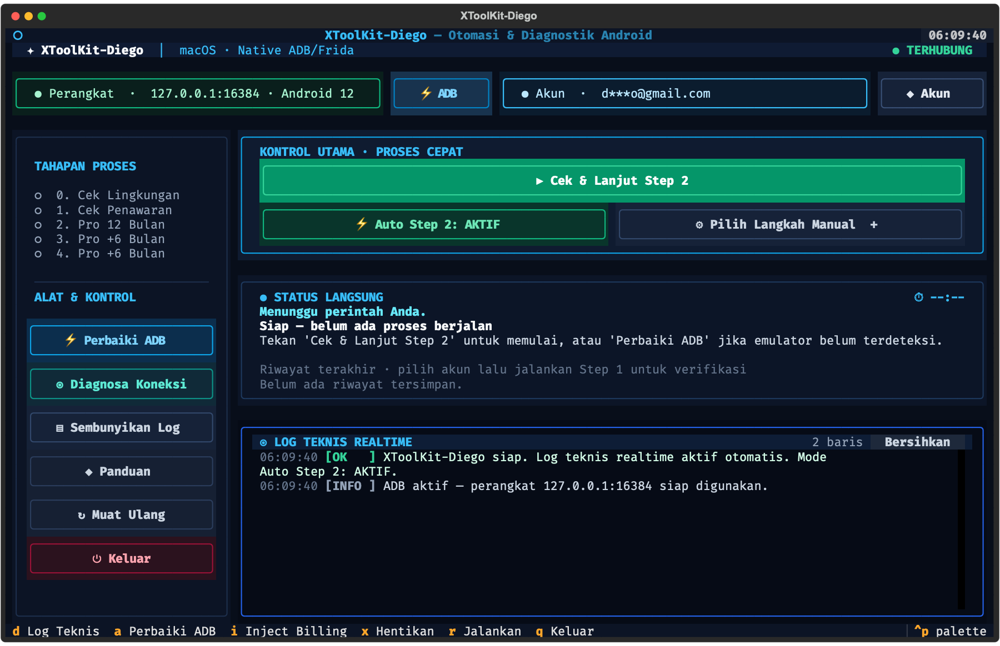
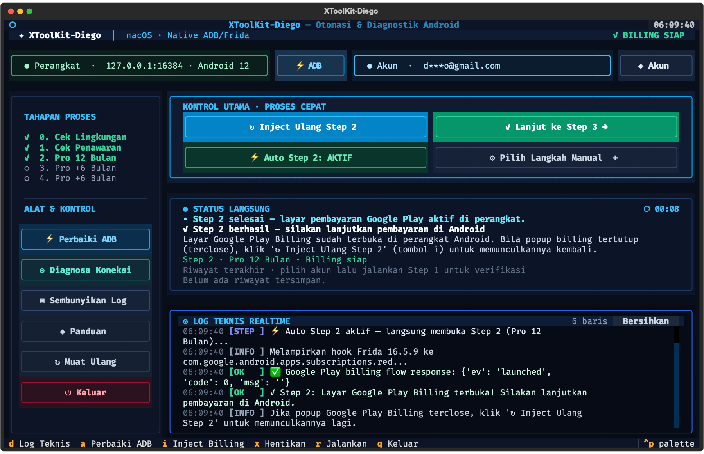
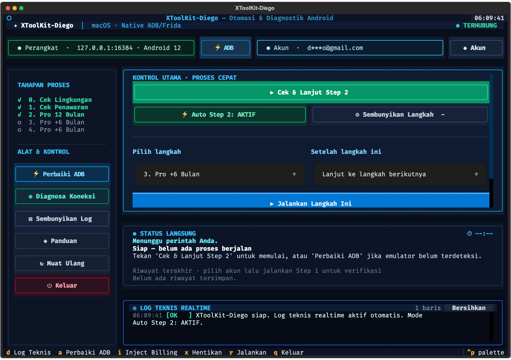
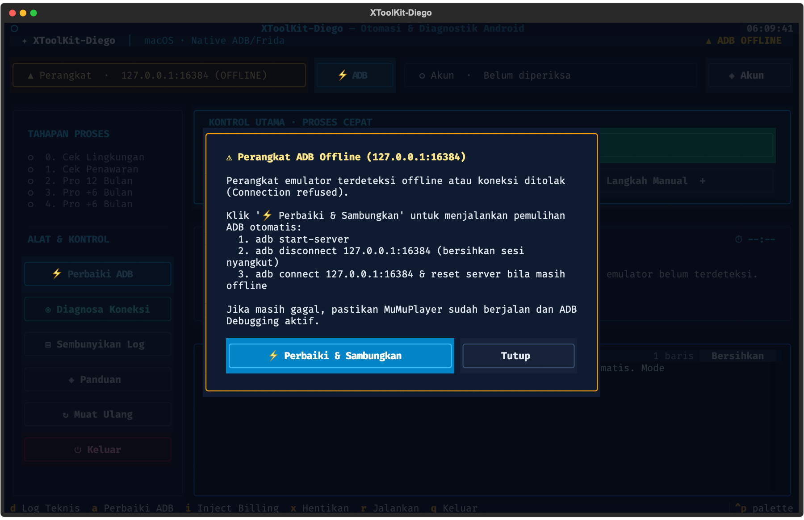

# ✦ XToolKit-Diego

[Pusat Dokumentasi](docs/README.md) · [Panduan macOS](docs/MACOS-PREVIEW.md) · [Panduan Windows](docs/INSTALLATION.md) · [Cara Penggunaan](docs/USAGE.md) · [Pemecahan Masalah](docs/TROUBLESHOOTING.md) · [Keamanan & Penafian](docs/SAFETY.md)

**XToolKit-Diego** adalah perangkat utilitas terminal modern berbahasa Indonesia untuk memeriksa perangkat Android, memulihkan koneksi ADB secara otomatis, meninjau penawaran Google AI Pro melalui Google One & Google Play, serta menjalankan alur **Step 0 hingga Step 4** dengan kontrol cepat. Aplikasi ini berjalan secara native di **macOS** (Terminal zsh/bash) dan **Windows** (PowerShell), berbagi mesin Python, ADB, dan Frida yang sama antara dasbor Textual dan mode CLI.



> [!CAUTION]
> **Ini bukan perangkat resmi dari Google dan dapat memicu transaksi berbayar.** Pada tahap **Step 2–4**, aplikasi membuka alur Google Play Billing langsung di perangkat Android Anda. Munculnya penawaran di daftar, fase awal bertarif Rp0/US\$0, atau terbukanya layar pembayaran **tidak menjamin** akun Anda memenuhi syarat, mendapatkan masa gratis, atau berhasil memperpanjang langganan. Selalu periksa akun aktif, nominal tagihan hari ini, tarif periode berikutnya, dan tanggal perpanjangan langsung di **Google Play** sebelum menyelesaikan pembayaran. Menghentikan aplikasi tidak membatalkan transaksi yang sudah dikonfirmasi di Google Play.

> [!NOTE]
> **Siapkan saldo minimal sekitar US\$3 untuk 3 verifikasi terpisah sebesar US\$1 — bukan satu kali penarikan US\$3.** Pada alur **24 bulan** yang sering dirujuk pengguna, Step 2 (Pro 12 Bulan), Step 3 (Pro +6 Bulan), dan Step 4 (Pro +6 Bulan Ke-2) masing-masing dapat memicu **verifikasi kartu/pembayaran sekitar US\$1**: **3 × US\$1 = US\$3**. Tergantung bank dan status Google Play, nominal US\$1 umumnya berupa **penahanan otorisasi sementara (authorization hold)** dan bukan biaya permanen; nilai sebenarnya dapat berbeda. Saldo US\$3 hanyalah ilustrasi batas minimum, bukan tarif pasti atau jaminan kelayakan akun. Penahanan sementara dapat mengurangi saldo tersedia dan biasanya dikembalikan dalam **1–14 hari kerja** tergantung penerbit kartu. Setelah setiap tahap, selalu cek status langganan dan tanggal perpanjangan di Google Play. Lihat [penjelasan resmi Google Play tentang otorisasi dan biaya](https://support.google.com/googleplay/answer/6224192?hl=en).

---

## Fitur Utama

- **Antarmuka Modern *Cyber-Slate* (Bahasa Indonesia)** — Dasbor Textual responsif dengan kartu telemetri perangkat & akun, daftar tahapan **Step 0–4**, tombol aksi lebar, dan tata letak adaptif untuk layar besar maupun sempit.
- **Pemulihan ADB Otomatis (`⚡ Perbaiki ADB` / `a`)** — Menangani emulator ADB yang nyangkut (`127.0.0.1:16384 offline`, `Connection refused`, atau server ADB belum aktif) dengan urutan otomatis `adb start-server` → `adb disconnect` → `adb connect` → reset `kill-server` bila diperlukan.
- **Auto Step 2 Instan (`⚡ Auto Step 2: AKTIF / MANUAL`)** — Setelah Step 1 selesai dan penawaran 12 bulan (`12months-eft`) fase awal Rp0/US\$0 terverifikasi, sistem langsung melanjutkan ke Step 2 secara otomatis tanpa jeda dialog, atau dapat diubah ke mode manual kapan saja.
- **Peluncuran Billing Cepat & Inject Ulang (`↻ Inject Ulang Step 2 / 3 / 4`)** — Pada Step 2, Step 3, dan Step 4, begitu Google Play mengembalikan `Google Play billing flow response: {'ev': 'launched', 'code': 0}`, proses langsung ditandai berhasil agar Anda dapat menyelesaikan pembayaran di layar Android. Bila popup Google Play Billing tidak sengaja tertutup (*terclose*), tekan **`↻ Inject Ulang Step N`** (atau tombol `i`) untuk memunculkannya lagi tanpa mengulang dari awal.
- **Log Teknis Realtime Bersih & Tombol Hentikan (`■ Hentikan` / `x`)** — Konsol log teknis berwarna otomatis tampil sejak awal, bebas dari noise pergantian mode atau proses perbaikan ADB, serta dilengkapi tombol **`■ Hentikan`** yang aktif setiap kali proses berjalan.

---

## Penafian

**XToolKit-Diego** adalah proyek independen yang **tidak berafiliasi dengan, disponsori oleh, atau disetujui oleh Google, Google One, Google Play, NetEase, maupun MuMuPlayer**. Perangkat lunak disediakan *apa adanya* tanpa jaminan kelayakan promo, keberhasilan perpanjangan langganan, atau kompatibilitas di semua perangkat Android. Langkah persiapan lingkungan (Step 0) dapat mengubah konfigurasi ADB, Frida, atau jaringan pada emulator. Gunakan hanya pada akun dan perangkat yang Anda miliki atau memiliki izin resmi untuk mengelolanya. Baca selengkapnya di [Penafian Lengkap](DISCLAIMER.md) dan [Panduan Keamanan](SECURITY.md).

---

## 1. Persiapan & Prasyarat

Pilih konfigurasi yang sesuai dengan sistem operasi Anda. **Di macOS, Anda tidak memerlukan PowerShell** dan tidak boleh menjalankan skrip `.ps1` atau `setup_env.py` milik Windows.

| Komponen | macOS | Windows |
| --- | --- | --- |
| **Terminal** | **Terminal** (zsh atau bash) | **PowerShell 5.1 atau lebih baru** |
| **Python** | **Python 3.10+** (disarankan 3.11); peluncur otomatis membuat `.venv` | **Python 3.10+**, perintah `python` |
| **Android / Emulator** | Perangkat Android root atau emulator kompatibel (**MuMuPlayer Pro untuk Mac** mendukung Apple Silicon; Intel Mac perlu perangkat/emulator lain) | Perangkat/emulator Android dengan root & ADB aktif (**MuMuPlayer untuk Windows**) |
| **Aplikasi Android** | Google Play Store dan Google One terpasang & sudah login akun target | Sama di perangkat/emulator Android Anda |
| **ADB** | Pasang terpisah, mis. `brew install android-platform-tools`; uji dengan `adb devices` | Dapat dideteksi atau diunduh otomatis melalui Android SDK Platform-Tools |
| **Frida** | **16.5.9** otomatis dipasang di `.venv` | **16.5.9** disiapkan oleh peluncur Windows saat diperlukan |
| **Perintah Jalankan** | `sh run-macos.sh` atau klik ganda `XToolKit-Diego.command` | `.\run-all.ps1` |

Lihat panduan persiapan mendetail untuk [macOS](docs/MACOS-PREVIEW.md) dan [Windows](docs/INSTALLATION.md).

---

## 2. Instalasi & Menjalankan di macOS

1. Pastikan **Python 3.10+** (disarankan Python 3.11) dan **Android SDK Platform-Tools (ADB)** sudah terpasang:

   ```sh
   brew install android-platform-tools
   adb devices
   ```

2. Jalankan emulator Android / **MuMuPlayer Pro** (aktif root dan ADB debugging) atau sambungkan perangkat Android yang diizinkan. Pastikan Google Play Store dan Google One sudah login dengan akun yang ingin diperiksa.
3. Buka **Terminal** di folder proyek **XToolKit-Diego**, lalu jalankan:

   ```sh
   sh run-macos.sh
   ```

   Atau cukup **klik ganda file `XToolKit-Diego.command`** dari Finder untuk langsung membuka dasbor di Terminal.

Peluncur `run-macos.sh` otomatis menyiapkan lingkungan virtual `.venv`, memasang Textual dan **Frida 16.5.9**, lalu menampilkan dasbor **XToolKit-Diego** (Step 0–4) tanpa memulai transaksi otomatis. Opsi cepat macOS:

```sh
sh run-macos.sh                 # Buka dasbor interaktif XToolKit-Diego (Step 0–4)
sh run-macos.sh --check         # Step 0: Cek lingkungan ADB/root/Frida
sh run-macos.sh --list          # Step 1: Daftar penawaran saja (tanpa checkout)
sh run-macos.sh --step 2        # Buka dasbor dengan Step 2 terpilih (belum berjalan otomatis)
sh run-macos.sh --manual-step2  # Buka dasbor dengan Auto Step 2 dimatikan (mode manual)
sh run-macos.sh --help          # Tampilkan semua opsi peluncur
```

> [!TIP]
> Jika `adb devices` menampilkan `127.0.0.1:16384 offline` atau `Connection refused`, Anda tidak perlu mengetik perintah ADB manual berulang kali — cukup buka dasbor lalu klik **`⚡ Perbaiki ADB`** (atau tekan tombol **`a`**).

---

## 3. Instalasi & Menjalankan di Windows

### Langkah A — Pasang MuMuPlayer

1. Unduh MuMuPlayer versi Windows dari [situs resmi NetEase MuMuPlayer](https://www.mumuplayer.com/download/). Hindari sumber tidak resmi.
2. Setelah terpasang, jalankan emulator Android, aktifkan **akses Root** dan **ADB Debugging**.
3. Pastikan **Google Play Store** dan **Google One** terpasang serta sudah masuk ke akun Google yang ingin diperiksa.

### Langkah B — Jalankan XToolKit-Diego di PowerShell

Buka **PowerShell** di dalam folder proyek, lalu jalankan:

```powershell
.\run-all.ps1
```

Menjalankan `.\run-all.ps1` **tanpa argumen** akan langsung membuka dasbor interaktif **XToolKit-Diego** tanpa memulai pembayaran. Saat dibutuhkan, peluncur dapat membantu menyiapkan Textual, ADB, dan Frida 16.5.9 (tetapi tidak memasang MuMuPlayer secara otomatis).

Untuk memverifikasi koneksi ADB secara manual di PowerShell:

```powershell
adb devices
```

Pastikan status perangkat adalah `device` (bukan `offline` atau `unauthorized`). Jika ADB bermasalah, gunakan tombol **`⚡ Perbaiki ADB`** di dalam dasbor atau baca [Panduan Pemecahan Masalah](docs/TROUBLESHOOTING.md).

---

## 4. Panduan Penggunaan Dasbor

### Alur Cepat & Auto Step 2

Saat dasbor terbuka, konsol **◉ LOG TEKNIS REALTIME** langsung aktif di bagian bawah sehingga seluruh tahapan proses dapat dipantau secara langsung.

1. Pastikan kartu **Perangkat** di bagian atas menampilkan status hijau **`● TERHUBUNG`** (misalnya `127.0.0.1:16384`).
2. Secara bawaan, tombol **`⚡ Auto Step 2: AKTIF`** menyala. Klik tombol hijau utama **`▶ Cek & Lanjut Step 2`**:
   - Sistem menjalankan **Step 1 (Cek Penawaran)** terlebih dahulu untuk memverifikasi akun Google Play dan ketersediaan penawaran.
   - Jika penawaran `12months-eft` (fase awal Rp0/US\$0) terverifikasi, XToolKit-Diego **otomatis melanjutkan ke Step 2 (Pro 12 Bulan)** tanpa pop-up konfirmasi tambahan.
3. Jika Anda hanya ingin mengecek daftar penawaran tanpa langsung membuka Step 2, klik tombol **`⚡ Auto Step 2: AKTIF`** sekali hingga berubah menjadi **`○ Auto Step 2: MANUAL`**, lalu tekan **`▶ Cek Perangkat & Penawaran`**.

### Step 2–4: Billing Terbuka & Tombol Inject Ulang

Pada tahap **Step 2 (Pro 12 Bulan)**, **Step 3 (Pro +6 Bulan)**, dan **Step 4 (Pro +6 Bulan Ke-2)**, XToolKit-Diego menggunakan mode peluncuran cepat (`--open-only`):

- Begitu hook Frida menerima respons `✅ Google Play billing flow response: {'ev': 'launched', 'code': 0, 'msg': ''}`, proses **langsung selesai** tanpa menunggu pemindaian layar checkout yang lama.
- Status langsung berubah menjadi **`✓ BILLING SIAP`** dan Anda dapat menyelesaikan pembayaran secara manual di layar Android/emulator.
- **Popup billing tidak sengaja tertutup (*terclose*)?** Tekan tombol biru **`↻ Inject Ulang Step 2`** (atau **Step 3 / Step 4**, pintasan **`i`**) untuk memunculkan ulang dialog Google Play Billing secara instan!
- Setelah pembayaran selesai dan **Anda sudah memverifikasi status langganan serta tanggal perpanjangan di Google Play**, tekan **`✓ Lanjut ke Step 3 →`** (atau ke **Step 4**).



### Pilih Langkah Manual (Step 0–4)

Klik **`⚙ Pilih Langkah Manual +`** untuk membuka panel pemilihan langkah secara manual:



Di bagian **Pilih langkah**, Anda dapat memilih **Step 0** hingga **Step 4**, atau memilih **`Opsi mode lanjutan…`** di baris paling bawah untuk membuka tiga mode urutan:

| Mode | Fungsi |
| --- | --- |
| **Berhenti setelah langkah ini** | Hanya menjalankan satu langkah terpilih (Step 0–4) |
| **Lanjut ke langkah berikutnya** | Menjalankan rangkaian terpandu mulai dari langkah terpilih (Step 2–4) |
| **Mulai berurutan dari Step 2** | Memulai rangkaian terpandu dari Step 2 hingga Step 4 |

### Ringkasan Tahapan (Step 0–4)

| Tahap | Nama di Dasbor | Fungsi | Risiko Pembayaran |
| --- | --- | --- | --- |
| **Step 0** | **Cek Lingkungan** | Memeriksa dan menyiapkan koneksi Android, ADB, root, dan Frida 16.5.9 | Tidak membuka checkout, tetapi dapat mengubah konfigurasi ADB/Frida/emulator |
| **Step 1** | **Cek Penawaran** | Memverifikasi akun aktif & membaca daftar penawaran Google Play | Tidak membuka checkout |
| **Step 2** | **Pro 12 Bulan** | Membuka layar Google Play Billing untuk penawaran awal 12 bulan (`12months-eft`) | **Dapat memicu tagihan/verifikasi pembayaran nyata** |
| **Step 3** | **Pro +6 Bulan** | Membuka layar pembaruan langganan tambahan 6 bulan pertama (`6months-eft`) | **Dapat memicu tagihan/verifikasi pembayaran nyata** |
| **Step 4** | **Pro +6 Bulan (Ke-2)** | Membuka layar pembaruan langganan tambahan 6 bulan kedua (`6months-eft-2`) | **Dapat memicu tagihan/verifikasi pembayaran nyata** |

**Ilustrasi alur 24 bulan melalui 3 verifikasi terpisah (wajib diverifikasi sendiri di Google Play):**

| Tahap | Estimasi Durasi Bila Diterima | Verifikasi Pembayaran Terpisah |
| --- | --- | --- |
| **Step 2 — Pro 12 Bulan** | **12 bulan** awal | **~US\$1** (transaksi ke-1) |
| **Step 3 — Pro +6 Bulan** | Akumulasi **18 bulan** | **~US\$1** (transaksi ke-2) |
| **Step 4 — Pro +6 Bulan (Ke-2)** | Akumulasi **24 bulan** | **~US\$1** (transaksi ke-3) |
| **Total Step 2–4** | **24 bulan bila terverifikasi di Google Play** | **3 × US\$1 = US\$3** (tiga verifikasi terpisah, bukan satu kali potong US\$3) |

> Nama *12 Bulan* dan *+6 Bulan* adalah label historis tahapan, bukan jaminan perpanjangan otomatis. Jika akun sudah memiliki langganan aktif, **jangan ulangi Step 2**. Selalu cek hasil nyata di [Langganan Google Play](https://play.google.com/store/account/subscriptions) setelah setiap pembayaran.

### Pemulihan Koneksi ADB Otomatis

Saat dasbor dalam keadaan siaga, XToolKit-Diego memantau perangkat ADB setiap 5 detik. Jika perangkat terdeteksi **`offline`** (seperti `127.0.0.1:16384 offline`), **`Connection refused`**, atau belum tersambung, popup pemulihan koneksi muncul secara otomatis:



Anda juga dapat memicu pemulihan kapan saja melalui tombol **`⚡ Perbaiki ADB`** di bilah kiri, tombol cepat **`⚡ ADB`** di sebelah kartu perangkat, atau pintasan keyboard **`a`**. XToolKit-Diego secara bertahap menjalankan `adb start-server`, membersihkan endpoint yang macet dengan `adb disconnect`, menyambungkan ulang `adb connect 127.0.0.1:16384`, hingga `adb kill-server` + `start-server` bila perangkat masih `offline`.

### Pintasan Keyboard & Kontrol Proses

| Tombol | Aksi | Keterangan |
| --- | --- | --- |
| **`d`** | **Log Teknis** | Menampilkan atau menyembunyikan konsol **Log Teknis Realtime** |
| **`a`** | **Perbaiki ADB** | Menjalankan pemulihan koneksi ADB otomatis |
| **`i`** | **Inject Billing** | Memunculkan ulang popup Google Play Billing untuk Step 2, 3, atau 4 |
| **`x`** | **Hentikan** | Menghentikan proses tahap yang sedang berjalan atau pemulihan ADB aktif |
| **`r`** | **Jalankan** | Menjalankan langkah yang sedang dipilih pada panel manual |
| **`q`** | **Keluar** | Keluar dari XToolKit-Diego dengan aman |

Saat sebuah langkah sedang berjalan, tombol aksi lain dikunci otomatis untuk mencegah eksekusi ganda, sementara **`■ Hentikan`** (`x`), **Panduan**, dan **Log Teknis Realtime** tetap dapat diakses.

---

## 5. Mode CLI Lanjutan

Selain dasbor interaktif, XToolKit-Diego menyediakan antarmuka baris perintah (CLI) terpisah sesuai sistem operasi.

### CLI macOS (`run-macos.sh` & `macos_runner.py`)

```sh
# Pengecekan tanpa transaksi
sh run-macos.sh --check          # Step 0: Cek lingkungan
sh run-macos.sh --list           # Step 1: Daftar penawaran saja

# Membuka dasbor dengan konfigurasi awal
sh run-macos.sh --step 2         # Buka dasbor langsung di Step 2
sh run-macos.sh --step 3 --sequence
sh run-macos.sh --manual-step2   # Matikan Auto Step 2 saat dibuka

# Inject ulang billing langsung via adapter macOS (Step 2–4, membutuhkan izin eksplisit)
.venv/bin/python macos_runner.py --step 2 --confirm-checkout --reinject
```

### CLI Windows PowerShell (`run-all.ps1`)

> Khusus **Windows**. Jangan gunakan skrip PowerShell di macOS.

**Pemeriksaan tanpa pembayaran:**

```powershell
.\run-all.ps1 -Step 0            # Cek lingkungan
.\run-all.ps1 -Step 1            # Daftar penawaran saja
.\run-all.ps1 -Step 1 -Debug     # Daftar penawaran + log lengkap
.\run-all.ps1 -Cli               # Mode CLI klasik (Step 1)
```

**Menjalankan tahap pembayaran secara langsung (dapat memicu transaksi nyata):**

```powershell
.\run-all.ps1 -Step 2
.\run-all.ps1 -Step 3
.\run-all.ps1 -Step 4
.\run-all.ps1 -Step 2 -Reinject  # Inject ulang popup billing Step 2
```

**Rangkaian terpandu dengan konfirmasi angka (`1 = Lanjutkan`, `2 = Lewati`, `0 = Berhenti`):**

```powershell
.\run-all.ps1 -AllStages
.\run-all.ps1 -AllStages -StartStep 3
```

**Menentukan serial perangkat atau akun target:**

```powershell
.\run-all.ps1 -Step 1 -Serial 127.0.0.1:16384
.\run-all.ps1 -AllStages -Email "akun@gmail.com"
```

Log tersimpan lokal di `logs/` dan laporan terbaru di `ultra0-report/`. **Jangan pernah membagikan log mentah atau laporan JSON** yang masih berisi email, token penawaran/pembelian, atau informasi kartu.

---

## 6. Hasil & Pemecahan Masalah Ringkas

- **`127.0.0.1:16384 offline` atau `Connection refused`:** Klik **`⚡ Perbaiki ADB`** (`a`). Jika tetap `Connection refused`, pastikan MuMuPlayer sudah berjalan penuh, ADB Debugging aktif, lalu klik ulang.
- **Popup Google Play Billing tertutup sebelum selesai bayar:** Klik **`↻ Inject Ulang Step 2 / 3 / 4`** (`i`) untuk memunculkannya lagi tanpa mengulang Step 1.
- **Gagal melampirkan Frida:** Cek **Log Teknis Realtime**; pastikan **Frida 16.5.9** sesuai dengan arsitektur perangkat/emulator Android.
- **Penawaran kosong atau `offer_query_failed`:** Buka Google One dan Google Play Store di Android, pastikan akun sudah login benar, lalu jalankan ulang Step 1.
- **Akun tidak cocok (`wrong_account` / `account_unverified`):** Samakan profil Google aktif di Google Play Store dan Google One; jangan melewati pemeriksaan akun.
- **`already_subscribed` atau `ineligible`:** Hentikan proses dan cek tanggal perpanjangan langsung di [Langganan Google Play](https://play.google.com/store/account/subscriptions).
- **Kesalahan keamanan pembayaran (mis. `OR-REH-04`):** Hentikan percobaan ulang dan ikuti petunjuk verifikasi di Google Payments / Keamanan Akun Google.

Untuk panduan lengkap beserta arti semua kode error, baca [Pemecahan Masalah](docs/TROUBLESHOOTING.md) dan [Panduan Teknis Mendalam](docs/DETAILED-GUIDE.md).

---

## 7. Struktur Proyek

| Lokasi | Fungsi |
| --- | --- |
| `run-macos.sh`, `XToolKit-Diego.command`, `macos_runner.py` | Peluncur native macOS dan adapter tahapan Step 0–4 (termasuk `--open-only` & `--reinject`) |
| `run-all.ps1` | Peluncur utama Windows (Dasbor Textual & CLI PowerShell Step 0–4) |
| `tui.py`, `tui_core.py` | Antarmuka dasbor modern Textual, status realtime, pemetaan tahapan, dan interpretasi laporan |
| `device_diagnostics.py`, `stage_history.py` | Diagnostik koneksi Android, pemulihan ADB otomatis, dan penyimpanan riwayat per akun |
| `ultra0.py`, `setup_env.py`, `device_selector.py`, `query_sku.py` | Mesin inti Android/ADB/Frida, pemilihan perangkat, dan utilitas kueri penawaran |
| [`tools/windows/`](tools/windows/README.md) | Skrip bantuan instalasi lingkungan Windows manual (opsional) |
| [`legacy/windows/`](legacy/windows/README.md) | Pintasan `.bat` historis (sebagian memakai `--force`; disarankan tetap memakai peluncur utama) |
| `scripts/`, `assets/` | Utilitas diagnostik runtime dan aset Android/Frida (`assets/frida/billing.js`, `assets/modules/`) |
| `tests/`, `docs/`, `images/` | Suite pengujian offline (mock), dokumentasi Bahasa Indonesia, dan tangkapan layar UI |

---

## 8. Pusat Dokumentasi

- [Pusat Dokumentasi (`docs/README.md`)](docs/README.md) — Daftar lengkap seluruh panduan
- [Panduan Instalasi & Penggunaan macOS](docs/MACOS-PREVIEW.md)
- [Panduan Instalasi Windows](docs/INSTALLATION.md)
- [Panduan Lengkap Dasbor & CLI](docs/USAGE.md)
- [Pemecahan Masalah (Troubleshooting)](docs/TROUBLESHOOTING.md)
- [Panduan Teknis Mendalam](docs/DETAILED-GUIDE.md)
- [Keamanan, Pembayaran & Penafian](docs/SAFETY.md)
- [Struktur Proyek](docs/PROJECT.md) · [Referensi Tahapan Step 0–4](docs/ORIGINAL-STEPS.md) · [Catatan Teknis](docs/AUTHOR-NOTES.md) · [Uji Coba Windows](docs/WINDOWS-SMOKE-TEST.md)
- [Penafian Lengkap](DISCLAIMER.md) · [Kebijakan Keamanan](SECURITY.md) · [Pemberitahuan Pihak Ketiga](THIRD_PARTY_NOTICES.md)
