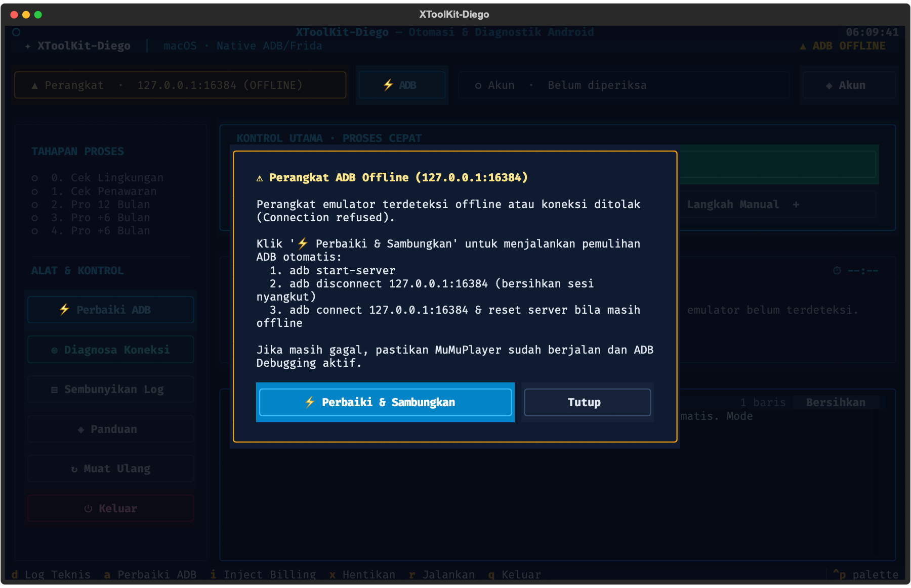

# Pemecahan Masalah (Troubleshooting) — XToolKit-Diego

[Pusat Dokumentasi](README.md) · [README Utama](../README.md) · [Panduan Teknis Mendalam](DETAILED-GUIDE.md) · [Keamanan](SAFETY.md)

Panduan ini merangkum gangguan paling sering ditemui saat menjalankan **XToolKit-Diego** beserta langkah penanganannya yang aman.

---

## 1. Masalah Koneksi ADB (`offline` & `Connection refused`)



Jika emulator MuMuPlayer sudah berjalan tetapi `adb devices` menampilkan:

```text
failed to connect to '127.0.0.1:16384': Connection refused
List of devices attached
127.0.0.1:16384    offline
```

**Solusi langsung di dalam XToolKit-Diego:**

1. Klik **`⚡ Perbaiki ADB`** di panel kiri, tombol cepat **`⚡ ADB`** di sebelah kartu perangkat, tombol **`⚡ Perbaiki & Sambungkan`** pada popup, atau cukup tekan tombol **`a`** di keyboard.
2. XToolKit-Diego otomatis menjalankan urutan pemulihan:
   - `adb start-server`
   - `adb disconnect 127.0.0.1:16384` (membersihkan sesi yang nyangkut `offline`)
   - `adb connect 127.0.0.1:16384`
   - Bila masih `offline`, menjalankan `adb kill-server` → `adb start-server` → `adb connect 127.0.0.1:16384`.
3. Jika pesan **`Connection refused`** tetap muncul setelah pemulihan, artinya layanan ADB di sisi emulator belum aktif atau port berubah:
   - Pastikan **MuMuPlayer** sudah selesai booting penuh.
   - Aktifkan **ADB Debugging** dan **Root** di pengaturan emulator.
   - Restart MuMuPlayer bila perlu, lalu klik **`⚡ Perbaiki ADB`** kembali.

---

## 2. Daftar Masalah Umum & Solusinya

| Masalah atau Status | Penyebab & Langkah Penanganan |
| --- | --- |
| **Popup Google Play Billing tertutup (*terclose*) saat Step 2, 3, atau 4** | Tidak perlu mengulang dari Step 1. Tekan tombol biru **`↻ Inject Ulang Step N`** di dasbor (atau tekan tombol **`i`**) untuk memunculkan ulang dialog Google Play Billing secara instan. |
| **MuMu / ADB tidak terdeteksi** | Pastikan MuMuPlayer sudah berjalan, Root dan ADB Debugging aktif, lalu tekan **`⚡ Perbaiki ADB`** (`a`) atau klik **`◎ Diagnosa Koneksi`**. |
| **Gagal melampirkan / memasang Frida** | Periksa **Log Teknis Realtime**. Versi **Frida 16.5.9** wajib cocok dengan arsitektur perangkat/emulator Android (`arm64-v8a` / `x86_64`). |
| **Penawaran kosong atau `offer_query_failed`** | Buka **Google One** dan **Google Play Store** secara manual di Android, pastikan sudah login akun yang benar, lalu jalankan ulang **Step 1**. |
| **Google One / Play Store gagal dibuka** | Pada Step 1, aplikasi mencoba membuka ulang aplikasi sekali secara otomatis. Jika tetap gagal, tutup lalu buka ulang MuMuPlayer, tunggu Android selesai boot, lalu jalankan Step 1 kembali. |
| **Item tidak tersedia untuk dibeli** | Google Play tidak menyediakan penawaran untuk akun atau negara Play tersebut. Periksa akun aktif, negara Play Store, dan ketersediaan Google One. |
| **Google One atau Play Store tidak terpasang** | Pasang Google One dari Play Store, atau pastikan image Android emulator yang digunakan sudah menyertakan Google Play Services & Play Store. |
| **Step 2–4 terkunci** | Selesaikan **Step 1 (Cek Penawaran)** terbaru terlebih dahulu hingga perangkat dan akun Play terverifikasi pada sesi aktif. |
| **Akun tidak terverifikasi / salah akun (`wrong_account`)** | Buka Google Play Store dan Google One di Android, samakan profil akun aktif, lalu jalankan ulang Step 1. Jangan melewati pemeriksaan akun dengan `--force`. |
| **Checkout terbuka di akun yang berbeda** | Tutup jendela checkout di Android, pilih profil yang benar di Google Play Store dan Google One, lalu ulangi dari Step 1. |
| **`billing_opened` / `checkout_requested`** | Layar pembayaran Google Play berhasil diluncurkan. Status ini **bukan bukti transaksi selesai** — selesaikan pembayaran di layar Android lalu cek sendiri status langganan di Google Play. |
| **`already_subscribed` atau `ineligible`** | Hentikan proses dan jangan memaksa lanjut ke tahap berikutnya. Periksa tanggal perpanjangan aktif langsung di Google Play. |
| **Blokir keamanan pembayaran (`OR-REH-04`)** | Hentikan seluruh percobaan pembayaran. Ikuti instruksi keamanan resmi di [Google Payments](https://payments.google.com/) dan [Keamanan Akun Google](https://myaccount.google.com/security). Jangan mengulangi checkout berulang kali. |
| **Error karakter Unicode di Windows** | Pastikan memakai peluncur `run-all.ps1` terbaru yang sudah mengatur encoding UTF-8 secara otomatis untuk semua proses Python. |

---

## 3. Verifikasi Akhir di Google Play

Setelah menyelesaikan pembayaran pada **Step 2**, **Step 3**, atau **Step 4**, selalu periksa sendiri:

- Status paket aktif
- Nominal tagihan dan mata uang
- Tanggal perpanjangan berikutnya

Langsung melalui **[Langganan Google Play](https://play.google.com/store/account/subscriptions)** sebelum menekan **`✓ Lanjut ke Step Berikutnya →`**.

Untuk kode error tingkat pengembang, diagnostik `ActivityThread`, dan kompatibilitas Android 15/Frida, baca [Panduan Teknis Mendalam](DETAILED-GUIDE.md).
