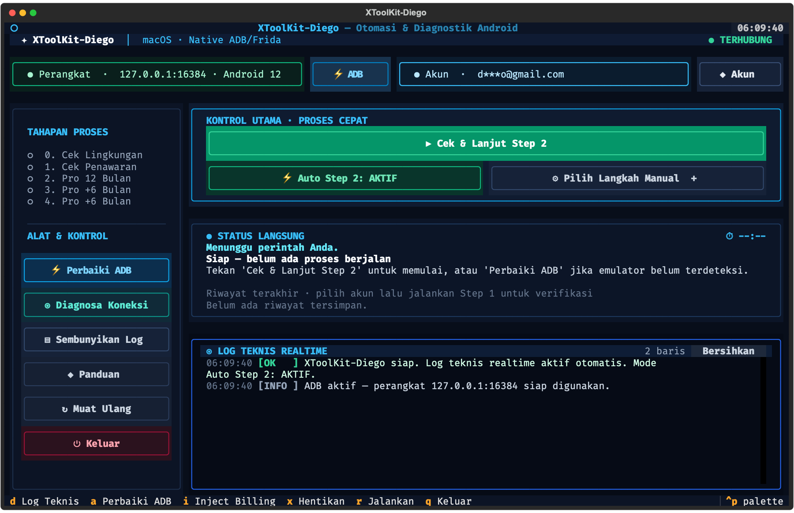
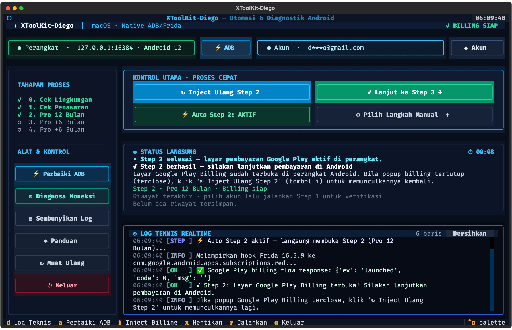
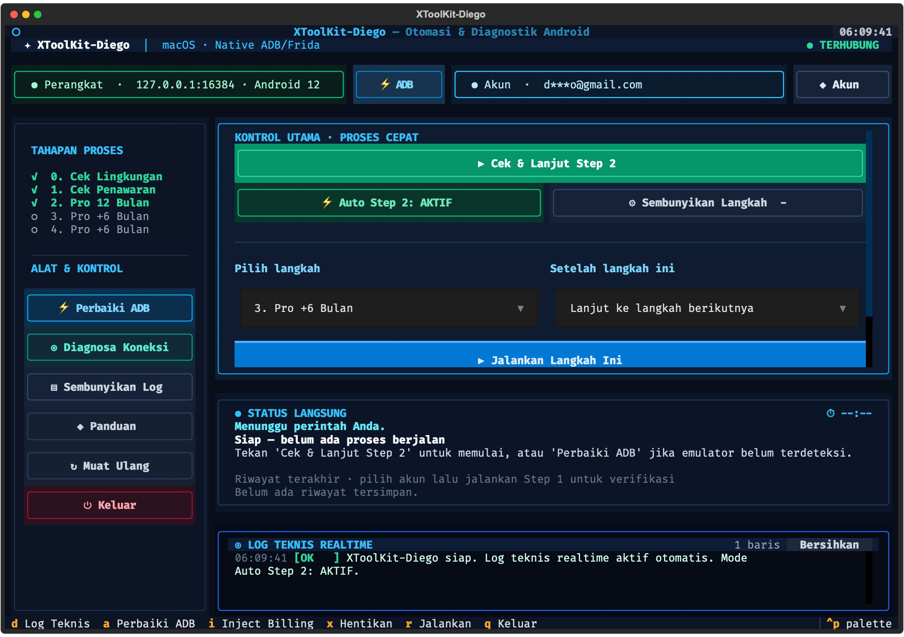
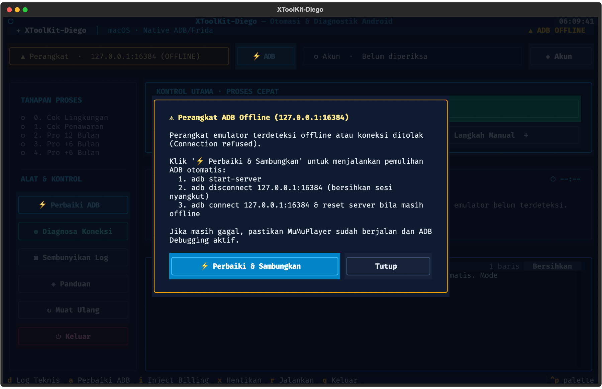

# Panduan Penggunaan Dasbor & CLI — XToolKit-Diego

[Pusat Dokumentasi](README.md) · [README Utama](../README.md) · [Keamanan](SAFETY.md) · [Pemecahan Masalah](TROUBLESHOOTING.md)

Panduan ini menjelaskan seluruh fitur **dasbor interaktif Textual XToolKit-Diego** dan cara memakai **mode CLI** di macOS maupun Windows.

---

## 1. Mengenal Tampilan Dasbor XToolKit-Diego



Dasbor terbagi menjadi empat area utama:

1. **Bilah Atas & Kartu Telemetri:**
   - Menampilkan judul **✦ XToolKit-Diego**, platform aktif (`macOS · Native ADB/Frida` atau `Windows · MuMu/ADB`), dan lencana status realtime (`● TERHUBUNG`, `◉ STEP 2 · 4d`, `✓ BILLING SIAP`, atau `▲ ADB OFFLINE`).
   - **Kartu Perangkat:** Menampilkan serial ADB, versi Android, dan arsitektur CPU (ABI) ketika terbaca, didampingi tombol cepat **`⚡ ADB`**.
   - **Kartu Akun:** Menampilkan email akun Google yang disamarkan (mis. `d***o@gmail.com`) setelah terverifikasi, didampingi tombol **`◈ Akun`** untuk memilih profil kandidat di perangkat.
2. **Panel Kiri (Tahapan Proses & Alat Kontrol):**
   - Daftar 5 tahapan (**Step 0** hingga **Step 4**) lengkap dengan indikator status (`○` menunggu, `◉` berjalan, `✓` selesai, `↺` riwayat sebelumnya).
   - Tombol kontrol cepat: **`⚡ Perbaiki ADB`**, **`◎ Diagnosa Koneksi`**, **`▤ Sembunyikan/Tampilkan Log`**, **`◈ Panduan`**, **`↻ Muat Ulang`**, dan **`⏻ Keluar`**.
3. **Panel Utama (Kontrol Cepat & Status Langsung):**
   - **Kontrol Utama:** Tombol aksi utama (`▶ Cek & Lanjut Step 2`), toggle **`⚡ Auto Step 2: AKTIF / MANUAL`**, tombol **`⚙ Pilih Langkah Manual +`**, tombol **`■ Hentikan`** (muncul setiap proses berjalan), serta tombol kontekstual **`↻ Inject Ulang Step N`** dan **`✓ Lanjut ke Step N →`** saat layar pembayaran siap.
   - **Status Langsung:** Menampilkan aktivitas terbaru, durasi berjalan (`⏱ MM:SS`), ringkasan hasil langkah, daftar penawaran, dan riwayat terakhir per akun.
4. **Konsol Log Teknis Realtime (Otomatis Tampil):**
   - Langsung aktif saat aplikasi dibuka, menampilkan stempel waktu (`HH:MM:SS`) dan tag warna (`[OK]`, `[STEP]`, `[INFO]`, `[WARN]`, `[ERR]`).
   - Dirancang **bersih**: perubahan mode Auto/Manual dan proses perbaikan ADB tidak membanjiri log teknis sehingga alur eksekusi tetap mudah dibaca.

---

## 2. Alur Penggunaan Harian (Step 1 → Step 4)

### Langkah 1 — Pastikan Perangkat & Akun Siap

- Nyalakan emulator (**MuMuPlayer**) atau perangkat Android ber-root, aktifkan ADB Debugging, dan pastikan Google Play Store & Google One sudah login akun target.
- Jika kartu Perangkat berwarna kuning/merah (`OFFLINE` atau belum terdeteksi), klik **`⚡ Perbaiki ADB`** (atau tekan **`a`**).

### Langkah 2 — Jalankan Cek & Auto Step 2

- Dengan mode bawaan **`⚡ Auto Step 2: AKTIF`**, klik **`▶ Cek & Lanjut Step 2`**.
- Sistem menjalankan **Step 1 (Cek Penawaran)** terlebih dahulu.
- Jika penawaran `12months-eft` dengan fase awal Rp0/US\$0 terdeteksi untuk akun aktif, sistem **langsung otomatis melanjutkan ke Step 2 (Pro 12 Bulan)**.
- Jika Anda ingin berhenti di Step 1 saja untuk meninjau daftar penawaran, klik toggle **`⚡ Auto Step 2: AKTIF`** agar berubah menjadi **`○ Auto Step 2: MANUAL`** sebelum menekan tombol utama.

### Langkah 3 — Selesaikan Pembayaran & Gunakan Inject Ulang Bila Terclose



- Pada **Step 2, Step 3, dan Step 4**, begitu Frida melaporkan `✅ Google Play billing flow response: {'ev': 'launched', 'code': 0, 'msg': ''}`, XToolKit-Diego langsung menyelesaikan tugasnya (**`✓ BILLING SIAP`**) tanpa menunggu pemeriksaan harga checkout yang berlama-lama.
- Selesaikan pembayaran secara manual di layar perangkat/emulator Android Anda.
- **Jika popup Google Play Billing tidak sengaja tertutup (*terclose*):** klik **`↻ Inject Ulang Step 2`** (atau **Step 3 / Step 4**, pintasan **`i`**) untuk langsung memunculkan kembali jendela Google Play Billing pada tahap tersebut.
- Setelah pembayaran selesai, buka **[Langganan Google Play](https://play.google.com/store/account/subscriptions)** di Android untuk memastikan paket aktif dan tanggal perpanjangan sudah bertambah.
- Jika sudah terverifikasi, klik **`✓ Lanjut ke Step 3 →`** (lalu **`✓ Lanjut ke Step 4 →`** setelah Step 3 terverifikasi).

---

## 3. Memilih Langkah Manual & Mode Eksekusi

Klik **`⚙ Pilih Langkah Manual +`** untuk membuka pemilihan langkah individual:



- Pilih **0. Cek Lingkungan**, **1. Cek Penawaran**, **2. Pro 12 Bulan**, **3. Pro +6 Bulan**, atau **4. Pro +6 Bulan (Ke-2)**.
- Pilih **`Opsi mode lanjutan…`** di baris terakhir dropdown langkah untuk membuka tiga mode:
  1. **Berhenti setelah langkah ini** — hanya menjalankan satu tahap yang dipilih.
  2. **Lanjut ke langkah berikutnya** — memulai rangkaian terpandu dari tahap terpilih (Step 2–4).
  3. **Mulai berurutan dari Step 2** — memulai rangkaian terpandu dari Step 2 hingga Step 4.
- Tekan **`▶ Jalankan Langkah Ini`** (atau tombol **`r`**).

> **Penting:** Tahap **Step 2–4** baru terbuka setelah **Step 1** terbaru berhasil memverifikasi perangkat dan akun Google Play pada sesi aktif. Mengganti perangkat atau membuka ulang aplikasi mengharuskan pengecekan Step 1 baru agar tidak memakai data laporan lama (*stale report*).

---

## 4. Ringkasan Tahapan Step 0–4 & Rincian 3 × US\$1

| Tahap | Label | Peran | Risiko |
| --- | --- | --- | --- |
| **Step 0** | Cek Lingkungan | Cek/siapkan ADB, root, dan Frida 16.5.9 | Tidak checkout, tetapi dapat mengubah konfigurasi ADB/Frida |
| **Step 1** | Cek Penawaran | Membaca daftar penawaran akun aktif | Tidak checkout |
| **Step 2** | Pro 12 Bulan | Membuka penawaran awal 12 bulan (`12months-eft`) | **Dapat memicu tagihan/verifikasi pembayaran nyata** |
| **Step 3** | Pro +6 Bulan | Membuka pembaruan tambahan 6 bulan ke-1 (`6months-eft`) | **Dapat memicu tagihan/verifikasi pembayaran nyata** |
| **Step 4** | Pro +6 Bulan (Ke-2) | Membuka pembaruan tambahan 6 bulan ke-2 (`6months-eft-2`) | **Dapat memicu tagihan/verifikasi pembayaran nyata** |

**Contoh alur 24 bulan (wajib diverifikasi sendiri di Google Play):**

| Tahap | Estimasi Durasi | Verifikasi Pembayaran |
| --- | --- | --- |
| **Step 2** | 12 bulan awal | ~US\$1 (verifikasi ke-1) |
| **Step 3** | Total 18 bulan | ~US\$1 (verifikasi ke-2) |
| **Step 4** | Total 24 bulan | ~US\$1 (verifikasi ke-3) |
| **Total Step 2–4** | **24 bulan bila terverifikasi** | **3 × US\$1 = US\$3** (tiga verifikasi terpisah) |

---

## 5. Pemulihan ADB Otomatis, Riwayat & Penghentian Proses



- **Pemulihan ADB Otomatis:** Tekan **`⚡ Perbaiki ADB`** (`a`) atau klik **`⚡ Perbaiki & Sambungkan`** saat popup koneksi muncul. Urutan pemulihan: `adb start-server` → `adb disconnect` (untuk endpoint `offline`) → `adb connect 127.0.0.1:16384` → `adb kill-server` + `start-server` + sambung ulang bila masih macet.
- **Menghentikan Proses (`■ Hentikan` / `x`):** Tombol **`■ Hentikan`** otomatis tampil selama Step 0–4 atau pemulihan ADB berjalan. Menekan **`x`** menghentikan proses aktif secara aman dan membatalkan antrean Auto Step 2. Namun, penghentian aplikasi **tidak dapat membatalkan transaksi yang sudah dikonfirmasi di Google Play**.
- **Riwayat Tahapan:** XToolKit-Diego menyimpan ringkasan waktu mulai, status hasil, dan konfirmasi langkah di `logs/stage-history/` secara terpisah per akun. Ikon **`↺`** pada sidebar menandakan langkah pernah dijalankan pada riwayat lokal (bukan bukti langganan aktif).
- **Muat Ulang (`↻ Muat Ulang`):** Memuat ulang dasbor dengan sesi bersih saat tidak ada proses aktif.

---

## 6. Tabel Pintasan Keyboard

| Tombol | Fungsi |
| --- | --- |
| **`d`** | Tampilkan / sembunyikan konsol **Log Teknis Realtime** |
| **`a`** | Jalankan **Perbaiki ADB** otomatis |
| **`i`** | **Inject Ulang Billing** untuk Step 2, 3, atau 4 yang sedang siap |
| **`x`** | **Hentikan** proses atau pemulihan ADB yang sedang berjalan |
| **`r`** | **Jalankan** langkah yang terpilih di panel manual |
| **`q`** | **Keluar** dari XToolKit-Diego dengan aman |

---

## 7. Referensi Mode CLI

### macOS (`run-macos.sh` & `macos_runner.py`)

```sh
sh run-macos.sh                      # Buka dasbor XToolKit-Diego
sh run-macos.sh --check              # Step 0: Cek lingkungan
sh run-macos.sh --list               # Step 1: Daftar penawaran saja
sh run-macos.sh --step 2             # Buka dasbor langsung memilih Step 2
sh run-macos.sh --manual-step2       # Buka dasbor tanpa Auto Step 2

# Menjalankan/inject ulang langsung via macos_runner.py (Step 2–4 perlu flag persetujuan eksplisit)
.venv/bin/python macos_runner.py --step 2 --confirm-checkout
.venv/bin/python macos_runner.py --step 2 --confirm-checkout --reinject
```

### Windows PowerShell (`run-all.ps1`)

```powershell
# Tanpa transaksi
.\run-all.ps1                        # Buka dasbor XToolKit-Diego
.\run-all.ps1 -Step 0                # Cek lingkungan
.\run-all.ps1 -Step 1                # Cek daftar penawaran
.\run-all.ps1 -Step 1 -Debug         # Cek penawaran + log teknis penuh
.\run-all.ps1 -Cli                   # Mode CLI klasik (Step 1)

# Tahap pembayaran individual (langsung berjalan tanpa konfirmasi ulang PowerShell)
.\run-all.ps1 -Step 2
.\run-all.ps1 -Step 3
.\run-all.ps1 -Step 4
.\run-all.ps1 -Step 2 -Reinject      # Inject ulang popup billing Step 2

# Rangkaian terpandu dengan konfirmasi angka (1 = Lanjutkan, 2 = Lewati, 0 = Berhenti)
.\run-all.ps1 -AllStages
.\run-all.ps1 -AllStages -StartStep 3

# Menentukan serial perangkat atau email akun target
.\run-all.ps1 -Step 1 -Serial 127.0.0.1:16384
.\run-all.ps1 -AllStages -Email "akun@gmail.com"
```

Hindari penggunaan `-Force` di Windows CLI karena flag tersebut hanya melewati validasi kecocokan akun dan **tidak** melewati syarat promo maupun pembatasan pembayaran Google Play.
